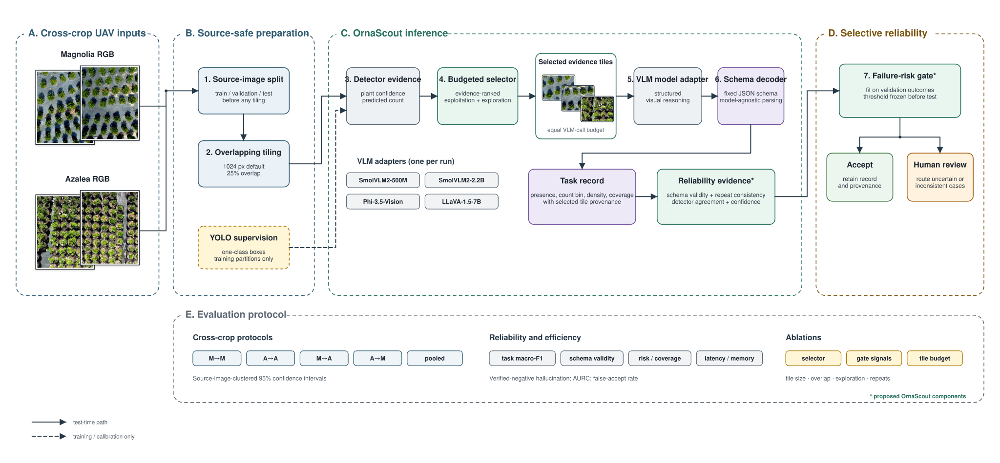
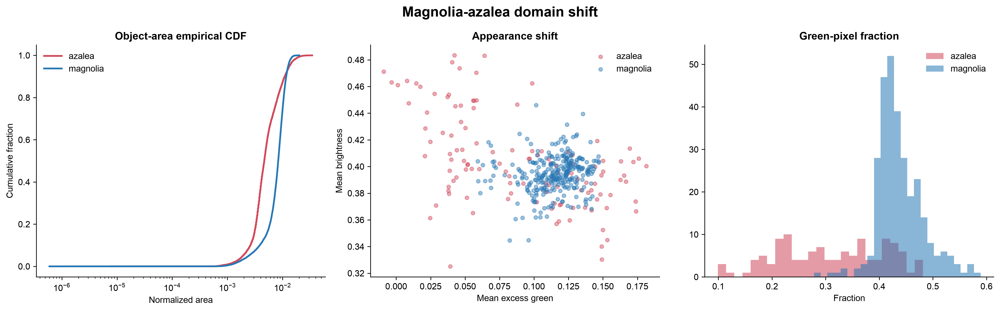
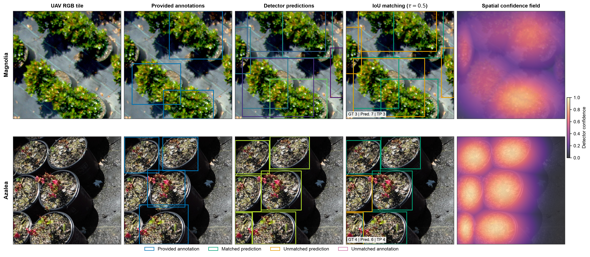

# OrnaScout

**Budgeted evidence selection for reliable cross-crop UAV ornamental scouting**

OrnaScout is a research pipeline for structured visual scouting across Magnolia
and Azalea nursery imagery. It splits source UAV images before tiling, learns
detector evidence from training data, selects a fixed visual-evidence budget,
and compares vision-language models under the same input cost. A
validation-calibrated gate can retain reliable records or defer uncertain cases
for human review.

> **Status:** Research prototype. Dataset preparation and the preliminary
> detector experiment are complete. Full VLM comparison, selector ablation, and
> selective-risk evaluation are still in progress; this repository does not
> present them as completed results.

## Method



The implemented path has five parts:

1. **Source-safe preparation:** split by source image before producing
   overlapping tiles, preventing neighboring views of the same image from
   leaking across train, validation, and test partitions.
2. **Detector evidence:** estimate candidate confidence and plant count for
   every tile using a one-class detector trained only on the training split.
3. **Budgeted evidence selection:** combine detector-ranked exploitation with
   controlled exploration while fixing the number of tiles supplied to every
   VLM.
4. **Structured VLM inference:** evaluate SmolVLM2-500M, SmolVLM2-2.2B,
   Phi-3.5-Vision, and LLaVA-1.5-7B through a shared JSON schema.
5. **Selective reliability:** calibrate a failure-risk threshold on validation
   data, freeze it, and then accept or defer test records.

For source image `I`, candidate tiles `T(I)`, and budget `B`, the selector
produces evidence set `E_B`, where `E_B` is a subset of `T(I)` and
`|E_B| <= B`. The default work-in-progress setting uses six ranked tiles and
two exploration tiles (`B = 8`).

## Verified Data Snapshot

The images and annotations are not distributed in this repository.

| Crop | Source images | Valid boxes | Native resolution |
|---|---:|---:|---:|
| Magnolia | 297 | 15,644 | 5184 x 3888 |
| Azalea | 121 | 14,198 | 5280 x 3956 |
| **Combined** | **418** | **29,842** | heterogeneous |

Source-image-safe preparation yields 14,630 tiles: 10,570 training, 2,030
validation, and 2,030 test tiles. The prepared set includes 1,328 hard-negative
tiles. See [the data card](docs/DATA_CARD.md) for annotation and exclusion
rules.

### Cross-crop shift



Magnolia and Azalea differ in appearance, object geometry, and annotation
density. This measured shift motivates separate within-crop, cross-crop, and
pooled protocols rather than treating the crops as exchangeable samples.

### Preliminary detector evidence



The panel compares source tiles, annotations, preliminary predictions,
matching quality, and spatial confidence for both crops. It is an audit figure,
not evidence of final cross-crop or VLM performance. A preliminary 15-epoch,
640-pixel detector run produced precision 0.911, recall 0.905, mAP50 0.965,
and mAP50-95 0.789; final reporting requires the frozen full protocol.

## Repository Layout

```text
.
├── assets/                         # Homepage architecture and audit figures
├── configs/models.json             # Verified model identifiers and roles
├── docs/                            # Data, protocol, figure, and status notes
├── submission/wacv2027/             # Audited paper and supplement release
├── adaptive_selector.py             # Fixed-budget evidence selection
├── detector_evidence.py             # Detector export, training, and inference
├── ornascout_pipeline_v2.py         # Preparation, merge, and evaluation logic
├── model_adapters.py                # Shared VLM loading and generation interface
├── run_vlm_wacv.py                  # Model-agnostic structured inference
├── selective_gate.py                # Validation-calibrated accept/defer gate
├── run_experiment.py                # Experiment orchestration
└── wacv_pipeline.py                 # Main command-line entry point
```

## Setup

Python 3.10 or 3.11 is recommended. Phi-3.5-Vision uses its official isolated
Transformers 4.43 environment because its remote implementation is not
compatible with newer cache APIs.

```bash
git clone https://github.com/harshitha-8/WACV-2026.git
cd WACV-2026
python3 -m venv .venv
source .venv/bin/activate
python -m pip install --upgrade pip
python -m pip install -r requirements.txt
cp experiment_config.example.json experiment_config.json
```

Edit only `experiment_config.json` to supply local image and YOLO-label roots.
The file is ignored by Git so local dataset paths are not committed. An
alternative configuration can be selected with `ORNA_CONFIG`.

## Reproducible Commands

```bash
# Validate image-label pairing and annotation structure
python wacv_pipeline.py inspect

# Generate source-level EDA and prepare source-safe tiles
python wacv_pipeline.py eda
python wacv_pipeline.py prepare

# Export and train detector evidence
python wacv_pipeline.py detector-export --scope combined
python wacv_pipeline.py detector-train --scope combined --device auto

# Select a fixed evidence budget
python wacv_pipeline.py select \
  --scope combined --split val --budget 8 --exploration 0.25 --strategy adaptive

# Runtime smoke test, followed by a full validation run
python wacv_pipeline.py smoke --scope combined --model smolvlm2_500m --device auto
python wacv_pipeline.py infer \
  --scope combined --model smolvlm2_500m --split val \
  --selection adaptive --budget 8 --exploration 0.25 --repeats 3 --device auto

# Evaluate completed prediction files
python wacv_pipeline.py evaluate --scope combined --split val
```

For Phi-3.5-Vision, first run `python wacv_pipeline.py setup-phi` with a Python
3.10/3.11 interpreter available. Detailed protocol boundaries and the required
ablation matrix are documented in
[EXPERIMENT_PROTOCOL.md](docs/EXPERIMENT_PROTOCOL.md).

## Evaluation Contract

The planned comparison reports source-image-clustered confidence intervals for
task macro-F1, count error, continuous coverage error, schema validity,
verified-negative hallucination, latency, peak memory, and risk-coverage
behavior. Selector baselines include random, uniform, top-ranked, and the
budgeted exploit-plus-explore strategy. Thresholds are fitted on validation
outputs only and frozen before test evaluation.

See [RESULTS_STATUS.md](docs/RESULTS_STATUS.md) for the explicit boundary
between completed measurements and pending experiments.

## Submission Sources

The audited WACV 2027 main-paper and supplementary Overleaf packages are kept
in [`submission/wacv2027`](submission/wacv2027). That directory includes the
unpacked source trees, the two upload-ready archives, and SHA-256 checksums.
Intermediate manuscript exports and local build products remain excluded.

## Scientific Boundary

OrnaScout currently studies two ornamental crops and their observed acquisition
domains. The repository does not claim universal nursery generalization, final
edge deployment, or completed VLM superiority. External-domain evaluation and
the full frozen test protocol are required before making those claims.

## License

Code is released under the [MIT License](LICENSE). Dataset access and usage are
governed separately by their owners and are not covered by this repository.
